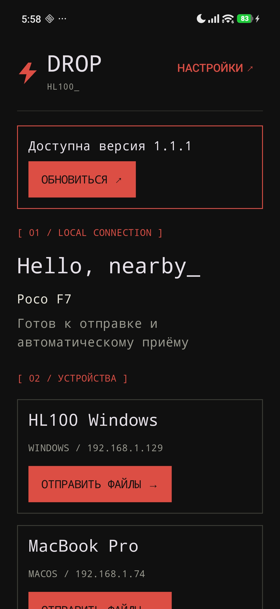
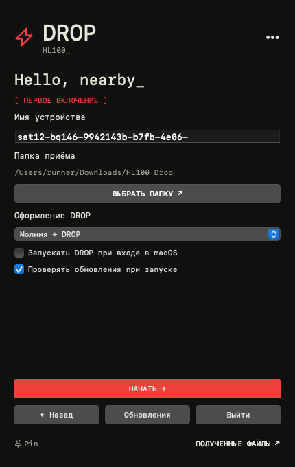

# DROP

### Файлы рядом. Без проводов.

Нативный файлообменник для Windows, Android и Mac.
Одна локальная сеть. Выбранное устройство. Прямой обмен файлами и папками.

**[Сайт DROP](https://cveloy102.github.io/hl100-drop/)** · **[Скачать](https://github.com/cveloy102/hl100-drop/releases/latest)** · **[Инструкция](docs/usage.md)** · **[Что нового](CHANGELOG.md)** · **[Сообщить об ошибке](https://github.com/cveloy102/hl100-drop/issues/new/choose)**

*DROP 1.1.0 на Windows: Mac и Android обнаружены в локальной сети. Оригинальный скриншот пользователя, 14 октября 2026 года.*

## От выбора устройства до готового файла

DROP обнаруживает другие устройства в той же локальной сети. Выберите получателя и отправьте файлы: приём происходит автоматически в выбранную папку. На компьютере можно перетащить файлы или папку прямо на карточку устройства.

| Возможность | Как работает |
| --- | --- |
| Файлы и папки | Вложенные и пустые папки, кириллица, сохранение структуры |
| Прямой обмен | Данные идут между устройствами по TCP, без облачного посредника |
| Пауза и продолжение | Управление на отправителе и получателе, начиная с 1.1 |
| Докачка | Автоматически после обрыва связи; сохраняется после выхода из приложений |
| Понятная история | Имя, размер, скорость и прогресс; папка отображается одним объектом |
| Открытие полученного | Нажатие на готовый файл или папку выделяет объект в Проводнике / Finder |
| Поделиться на Android | Галерея или другое приложение → «Поделиться» → DROP → устройство |
| Работа в фоне | Windows — трей, Mac — строка меню; Android — настраиваемый приём в фоне |
| Обновления | Проверка в настройках, плашка новой версии, загрузка по вашему действию |

## Начало работы

1. [Скачайте последний релиз](https://github.com/cveloy102/hl100-drop/releases/latest) для своих устройств.
2. При первом запуске задайте **имя** и **папку приёма**.
3. Подключите устройства к одной Wi-Fi / локальной сети и откройте DROP на обоих.
4. Выберите устройство и отправьте файлы. Получателю не нужно подтверждать каждую передачу.

**Windows 10+ x64 · Android 12+ ARM64 / x86_64 · macOS 12+ Intel и Apple Silicon.** Для обмена интернет не нужен. Интернет используется для проверки и скачивания обновлений.

[Установка, фон, папки и докачка — пошагово →](docs/usage.md)

## Пауза без нового старта

Под полосой прогресса нажмите **«Пауза»**, затем **«Продолжить»**. При потере связи DROP ждёт возвращения устройства и продолжает с записанного места. После выхода из приложений незавершённая передача восстанавливается; ручная пауза остаётся паузой.

Исходный файл должен оставаться доступным и неизменённым. Для докачки обновите обе стороны до 1.1 или новее. Старые клиенты продолжают обычный обмен. [Подробности и ограничения Android →](docs/usage.md#пауза-и-докачка)

## Нативно на каждой платформе

Windows использует WPF, Android — Jetpack Compose, Mac — AppKit. Общее ядро на Rust отвечает за обнаружение, TCP-поток и восстановление передач. Данные не сжимаются и не хешируются целиком перед отправкой; докачка не добавляет подтверждение на каждый блок. Скорость зависит от сети, накопителей и устройства; обещаний конкретных МБ/с нет.

*Настройки Windows 1.1.0 и доступное обновление до 1.1.1. Оригинальный скриншот пользователя.*

## На телефоне — отправка из галереи и файлов

*Настоящий DROP 1.1.0 на POCO F7 / Android 16, 14 октября 2026 года.*

## На Mac — в строке меню

<table><tr><td></td><td></td></tr></table>

*Настоящие AppKit views версии 1.1.1 с демонстрационными данными. Изображения получены в GitHub Actions, а не на пользовательском Mac.*

## Обновление из приложения

В **настройках** нажмите **«Проверить обновления»**, затем **«Обновиться»**. Windows запустит установщик, Android запросит установку APK, Mac откроет DMG: закройте DROP и замените приложение в «Программах». Не удаляйте приложение перед обновлением.

Для проверки доступен переход **1.1.0 → 1.1.1**. APK подписан тем же постоянным ключом; приложения проверяют SHA-256 загрузки. [Сценарий проверки обновления →](docs/updates.md)

## Помощь и документация

[Использование и FAQ](docs/usage.md) · [Обновления](docs/updates.md) · [История версий](CHANGELOG.md) · [Сборка и выпуск](docs/DEVELOPMENT.md) · [Результаты проверок](docs/validation.md)

DROP рассчитан на доверенную локальную сеть: авторизации и шифрования передачи нет, приём автоматический. macOS-сборки имеют ad hoc подпись без нотариализации Apple. Проверки минимальных версий ОС и конкретных сетей перечислены отдельно в [результатах проверок](docs/validation.md).

Дизайн: чёрный фон, тёплый белый, красный акцент и моноширинный текст в стиле [HL100](https://tg.hl100.ru). **HL100_ / DROP**
