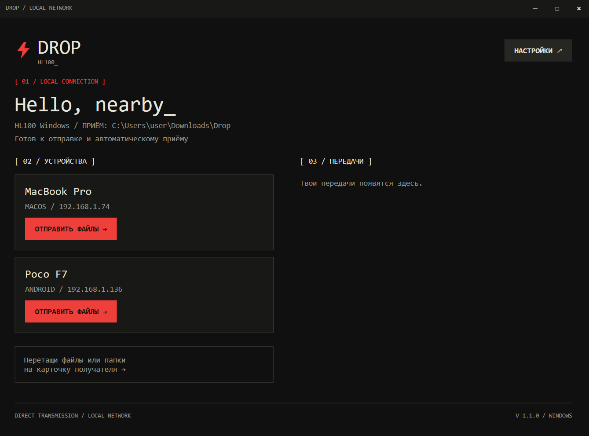
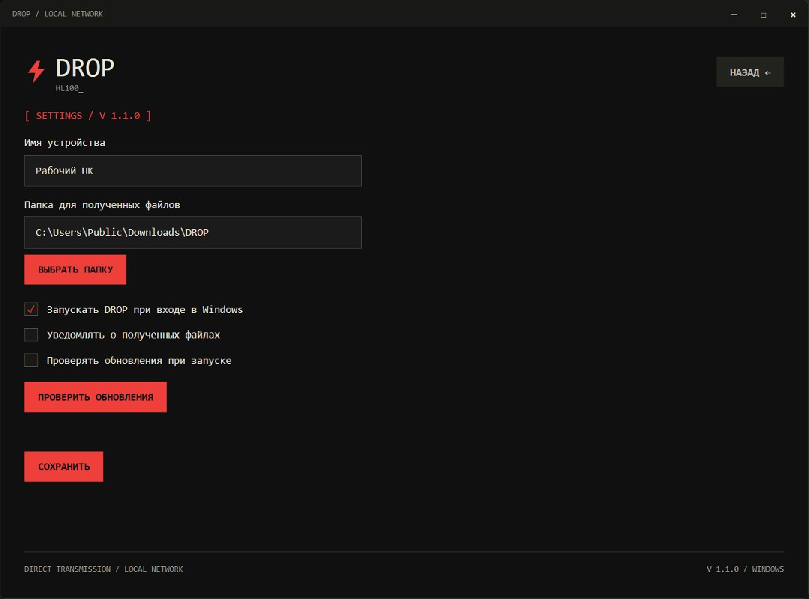
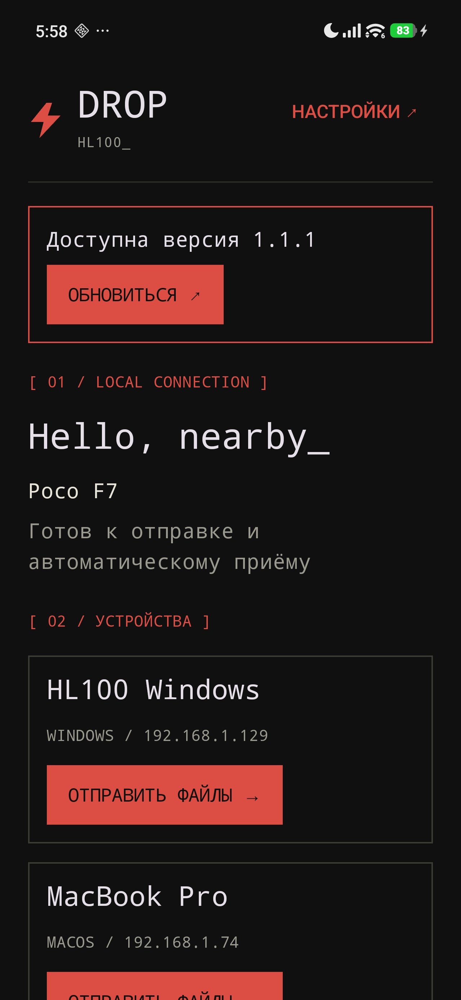
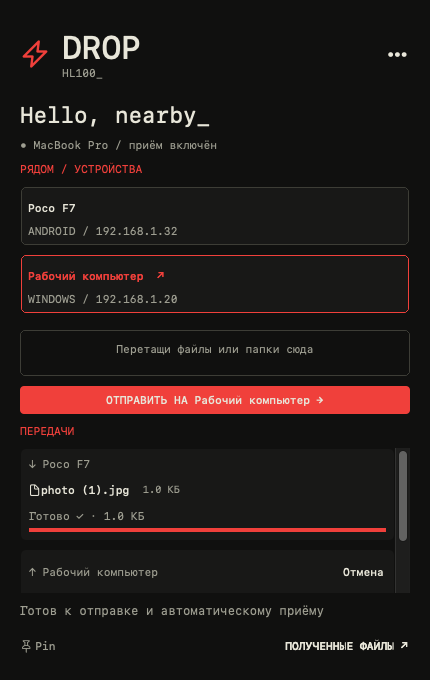

# DROP

Передавайте файлы и папки между телефоном, компьютером и Mac по одной **доверенной локальной сети**. DROP принимает файлы автоматически. Передача внутри сети идёт без шифрования.

## Что установить

Установите DROP на оба устройства. Для каждого выберите свою систему.

- **Windows 10+ x64** — [Установщик EXE](https://github.com/cveloy102/hl100-drop/releases/download/v1.1.4/HL100DropSetup-1.1.4.exe) · [Установка на Windows](docs/usage.md#установка-на-windows).
- **Android 12+ (ARM64, x86_64)** — [Приложение APK](https://github.com/cveloy102/hl100-drop/releases/download/v1.1.4/HL100Drop-1.1.4.apk) · [Установка на Android](docs/usage.md#установка-на-android).
- **Linux x86_64 (GTK 4.12+)** — пакет `.deb` для Debian / Ubuntu / Kali / Mint или `AppImage` для остальных дистрибутивов, со страницы [релизов](https://github.com/cveloy102/hl100-drop/releases) · [Установка на Linux](docs/usage.md#установка-на-linux).
- **macOS 12+ (Intel, Apple Silicon)** — [Образ DMG](https://github.com/cveloy102/hl100-drop/releases/download/v1.1.4/HL100Drop-1.1.4-universal.dmg) · [Установка на macOS](docs/usage.md#установка-на-macos).

## Начало работы

1. Подключите оба устройства к одной домашней сети и откройте на них DROP.
2. На каждом устройстве задайте имя и выберите папку приёма.
3. На отправителе выберите получателя по имени и отправьте небольшой файл. Откройте папку приёма на втором устройстве и проверьте, что файл появился.

*На снимке DROP 1.1.0 для Windows обнаружил Mac и телефон Android.*

**Если устройства не видят друг друга** — [проверить сеть и разрешения](docs/usage.md#устройство-не-появляется) · [сообщить об ошибке](https://github.com/cveloy102/hl100-drop/issues/new/choose).

[Страница приложения](https://cveloy102.github.io/hl100-drop/) · [Все версии](https://github.com/cveloy102/hl100-drop/releases) · [Полная инструкция](docs/usage.md)

## От выбора устройства до готового файла

DROP обнаруживает другие устройства в той же локальной сети. Выберите получателя и отправьте файлы: приём происходит автоматически в выбранную папку. На компьютере можно перетащить файлы или папку прямо на карточку устройства.

| Возможность | Как работает |
| --- | --- |
| Файлы и папки | Вложенные и пустые папки, кириллица, сохранение структуры |
| Прямой обмен | Данные идут между устройствами по TCP, без облачного посредника |
| Пауза и продолжение | Управление на отправителе и получателе, начиная с 1.1 |
| Докачка | Автоматически после обрыва связи; сохраняется после выхода из приложений |
| Понятная история | Имя, размер, скорость и прогресс; папка отображается одним объектом |
| Открытие полученного | Нажатие на готовый файл или папку выделяет объект в Проводнике / Finder |
| Поделиться на Android | Галерея или другое приложение → «Поделиться» → DROP → устройство |
| Работа в фоне | Windows и Linux — трей, Mac — строка меню; Android — настраиваемый приём в фоне |
| Обновления | Проверка в настройках, плашка новой версии, загрузка по вашему действию |

## Пауза без нового старта

Под полосой прогресса нажмите **«Пауза»**, затем **«Продолжить»**. При потере связи DROP ждёт возвращения устройства и продолжает с записанного места. После выхода из приложений незавершённая передача восстанавливается; ручная пауза остаётся паузой.

Исходный файл должен оставаться доступным и неизменённым. Для докачки обновите обе стороны до 1.1 или новее. Старые клиенты продолжают обычный обмен. [Подробности и ограничения Android →](docs/usage.md#пауза-и-докачка)

## Нативно на каждой платформе

Windows использует WPF, Android — Jetpack Compose, Mac — AppKit, Linux — GTK 4. Общее ядро на Rust отвечает за обнаружение, TCP-поток и восстановление передач. Данные не сжимаются и не хешируются целиком перед отправкой; докачка не добавляет подтверждение на каждый блок. Скорость зависит от сети, накопителей и устройства; обещаний конкретных МБ/с нет.

*Настройки Windows 1.1.0 и доступное обновление до 1.1.1. Оригинальный скриншот пользователя.*

## На телефоне — отправка из галереи и файлов

*Настоящий DROP 1.1.0 на POCO F7 / Android 16, 14 октября 2026 года.*

## На Mac — в строке меню

[Посмотреть настройки на Mac](docs/images/macos-settings.png)

*Настоящие AppKit views версии 1.1.1 с демонстрационными данными. Изображения получены в GitHub Actions, а не на пользовательском Mac.*

## Обновление из приложения

В **настройках** нажмите **«Проверить обновления»**, затем **«Обновиться»**. Windows запустит установщик, Android запросит установку APK, Mac откроет DMG: закройте DROP и замените приложение в «Программах». Не удаляйте приложение перед обновлением.

Для проверки доступен переход **1.1.0 → 1.1.1**. APK подписан тем же постоянным ключом; приложения проверяют SHA-256 загрузки. [Сценарий проверки обновления →](docs/updates.md)

## Помощь и документация

[Использование и FAQ](docs/usage.md) · [Обновления](docs/updates.md) · [История версий](CHANGELOG.md) · [Сборка и выпуск](docs/DEVELOPMENT.md) · [Результаты проверок](docs/validation.md)

DROP рассчитан на доверенную локальную сеть: авторизации и шифрования передачи нет, приём автоматический. macOS-сборки имеют ad hoc подпись без нотариализации Apple. Проверки минимальных версий ОС и конкретных сетей перечислены отдельно в [результатах проверок](docs/validation.md).

Дизайн: чёрный фон, тёплый белый, красный акцент и моноширинный текст в стиле [HL100](https://tg.hl100.ru). **HL100_ / DROP**

[Каталог приложений](https://cveloy102.github.io/#drop)
