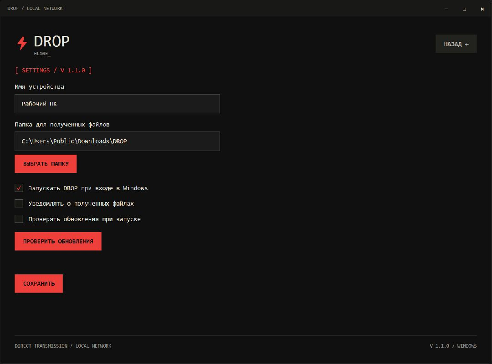
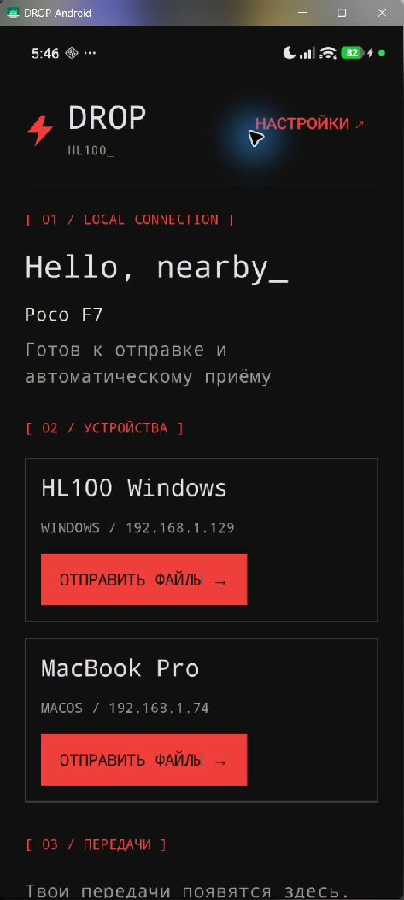
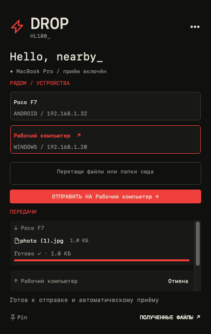
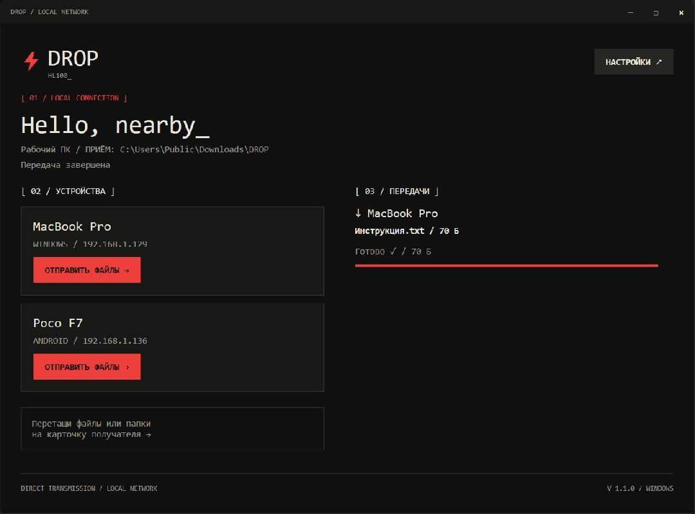

# DROP · инструкция

[← Обзор](../README.md) · [Скачать](https://github.com/cveloy102/hl100-drop/releases/latest) · [Обновления](updates.md)

## Установка на Windows

1. В **Assets** последнего релиза скачайте `HL100DropSetup-<версия>.exe`.
2. Запустите установщик. Права администратора не нужны; можно создать ярлык на рабочем столе.
3. Откройте **HL100 Drop** через меню «Пуск» или ярлык.
4. Задайте имя устройства и папку приёма, нажмите «Начать».
5. Если Windows запросит доступ через брандмауэр, разрешите DROP в своей частной локальной сети.

Требуется Windows 10 или новее, x64. Компоненты .NET входят в установщик. Закрытие окна оставляет приложение в трее; полный выход — через меню значка.

*Настоящий экран Windows 1.1.0 с демонстрационными настройками.*

## Установка на Android

1. Скачайте `HL100Drop-<версия>.apk` из **Assets** релиза.
2. Откройте APK и подтвердите установку. При необходимости разрешите установку из этого источника в системном запросе Android.
3. Откройте **DROP**, задайте имя и выберите локальную папку для сохранения.
4. Подтвердите системный доступ к выбранной папке и нажмите «Начать».

Требуется Android 12 или новее, ARM64 либо x86_64. При обновлении устанавливайте новый APK поверх старого: удаление приложения лишает его настроек и журналов докачки.

*Настоящий DROP 1.1.0 на POCO F7 / Android 16. Для документации история завершённых передач не показывается.*

## Установка на macOS

1. Скачайте `HL100Drop-<версия>-universal.dmg`.
2. Откройте DMG и перетащите **HL100 Drop.app** в **Applications / Программы**.
3. Запустите приложение, задайте имя и папку приёма.
4. DROP доступен в строке меню; файлы можно перетаскивать на получателя.

Требуется macOS 12 или новее. Один DMG для Intel и Apple Silicon, включая M1 Pro; Rosetta не требуется. Сборка подписана ad hoc, без Developer ID / нотариализации. Если macOS блокирует запуск, используйте доступный системный вариант разрешения запуска конкретного приложения в «Конфиденциальность и безопасность»; отключать защиту целиком не требуется.

*Настоящий интерфейс AppKit 1.1.1 с демонстрационными данными из CI.*

## Передача файлов

Откройте DROP на обоих устройствах и подключите их к одной локальной сети. Получатели появятся в разделе «Устройства».

- **Windows / Mac:** перетащите файлы или папку на нужное устройство либо используйте кнопку отправки.
- **Android:** нажмите «Отправить файлы» у нужного устройства. Выберите «Фото / видео», «Файлы» или «Папка», затем подтвердите системный выбор.
- **Из галереи и других приложений Android:** «Поделиться» → **DROP** → выберите устройство.

Файлы принимаются автоматически. Совпадающее имя не должно перезаписать существующий файл: новая копия получает суффикс. Папка показывается одной строкой с суммарным размером, вложенные файлы сохраняются внутри.

*Настоящий интерфейс, демонстрационное имя отправителя и тестовый текстовый файл.*

## Открытие полученного

После завершения нажмите название файла или папки на Windows / Mac: откроется Проводник / Finder с выделенным объектом. Во время приёма незавершённые объекты недоступны для открытия. Если файл перемещён или удалён вручную, прежняя ссылка больше не работает.

## Пауза и докачка

1. Во время активной передачи нажмите **«Пауза»** в карточке передачи.
2. Для возобновления нажмите **«Продолжить»**.
3. При потере сети появляется ожидание соединения. После возвращения устройства передача повторяет подключение автоматически.
4. Можно выйти из обоих приложений и открыть их снова. Незавершённая передача восстановится; если вы поставили её на паузу вручную, нужно нажать «Продолжить».

Для докачки обе стороны должны быть версии 1.1 или новее. Сохраняйте исходные файлы на месте и не редактируйте их. Завершённые файлы папки повторно не передаются. «Отменить» удаляет незавершённые части, уже законченные файлы остаются; до возвращения выключенного получателя отмена может ожидать связи.

Android: выбирайте локальную папку с поддержкой позиционной записи. Некоторые облачные провайдеры / потоковые источники не допускают докачку. Временный доступ из «Поделиться» может исчезнуть после выхода — тогда нужно снова выбрать источник. Не удаляйте внутреннюю папку `.drop-state` на компьютере, пока есть незавершённые передачи.

## Приём в фоне

**Windows:** закрытие окна оставляет DROP в трее. Автозапуск включается в настройках.

**Mac:** приложение работает в строке меню; настройки доступны в панели. Есть отдельное окно передач.

**Android:** постоянное уведомление не показывается для обычной работы открытого приложения. В настройках можно включить приём в фоне и выбрать его длительность. Активная фоновая работа требует уведомления Android. При остановке службы фоновый приём прекращается; ограничения батареи производителя могут влиять на длительность работы.

## FAQ

### Устройство не появляется

Проверьте одну локальную сеть, включённый приём и запущенный DROP на обоих устройствах. Гостевой Wi-Fi / изоляция клиентов, VPN и брандмауэр могут мешать обнаружению. Проверьте разрешение локальной сети на Mac и частную сеть в брандмауэре Windows.

### Передача идёт медленно

Проверьте качество Wi-Fi, диапазон, нагрузку и скорость накопителей. Подключение ПК по кабелю может помочь. DROP не обещает фиксированную скорость: реальная пропускная способность определяется устройствами и сетью.

### После перезапуска докачка не продолжается

Откройте оба приложения, проверьте доступность оригинала и разрешение к папке приёма. Ручную паузу нужно снять. На Android временный URI или непозиционный провайдер могут потребовать новую отправку.

### Не видно кнопки паузы

Она находится в карточке активной передачи и доступна после согласования докачки. У старого получателя её может не быть. После завершения кнопки скрываются.

### Обновление не найдено

Проверка требует интернета и доступа к GitHub. Обновление показывается только для более новой стабильной версии, а не предварительного релиза. [Проверка перехода 1.1.0 → 1.1.1](updates.md).

### Безопасно ли в чужой сети?

Приложение предназначено для доверенной локальной сети. У передачи нет шифрования / авторизации, файлы принимаются автоматически. Не используйте DROP как публичный файловый сервер.

### Как сообщить об ошибке?

[Создайте issue](https://github.com/cveloy102/hl100-drop/issues/new/choose). Укажите платформы, версии DROP, шаги и полный текст ошибки. Скриншот можно приложить после проверки личных данных в кадре.
